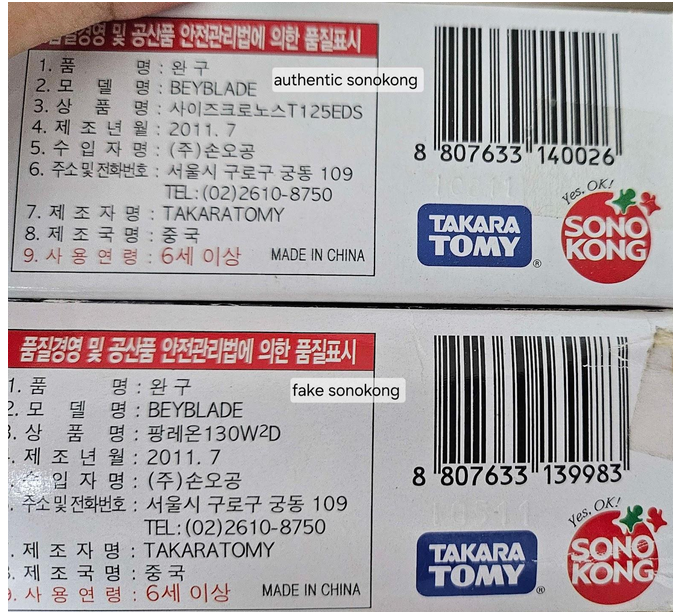
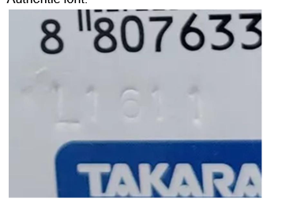
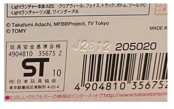

<!--
ARCHIVED SOURCE — Sonokong high-quality fakes and the Chinese midfake batch codes

  Author:   u/GodKillgroth (the same collector behind the r/Beyblade reference
            post archived beside this file as reddit-kzyzt1.md — the model-by-model
            compilation is the continuation of it, and supersedes its year-by-year
            listing in coverage).
  Received: 2026-10-19, supplied by the project owner as a file drop.
  URL:      NOT RECORDED. The midfake file links the author's Discord
            (https://discord.gg/kDGRYscs) as the place the Sonokong fake
            research lives; no public permalink for these two documents was
            captured at the time they were received.

🛑 So the provenance here is WEAKER than reddit-kzyzt1.md's, and the engine says
so: everything parsed out of these files carries 'reported' confidence rather
than 'verified' unless the older post corroborates it independently.

Kept verbatim on purpose: scripts/lib/authenticity-sources.mjs parses THIS FILE,
so the shipped table is reproducible from an archived source rather than from a
hand transcription of 777 rows. Do not tidy the typos, the blurry-photo hedges
or the two codes the author could not choose between — the parser carries each
of those through to the user as an explicit uncertainty.
ONE DEVIATION from verbatim: the three image references were renamed from
image.png / image-1.png / image-2.png to descriptive filenames, because the
originals were generic names that would collide in a shared sources directory.
The image bytes are unmodified. Nothing the parser reads was touched.
-->

Sonokong (Korean) high quality fakes/midfakes codes

H3011
I0511
I2211
I2611

More information about high quality Sonokong fakes/midfakes on https://discord.gg/kDGRYscs

Chinese midfake codes

Chinese midfake codes use a different font compared to authentic codes.

F2710
D0511, D2211, H0511 - appears on Metal Fury beys as well, the code itself should be authentic however the font looks like a midfake one
A0212
E2412
F1512
F2012
H2012
J0412
J0712
J2712
J2912
A0813
A0714
I2414
I2614
J1314

Authentic font:

Midfake font:

